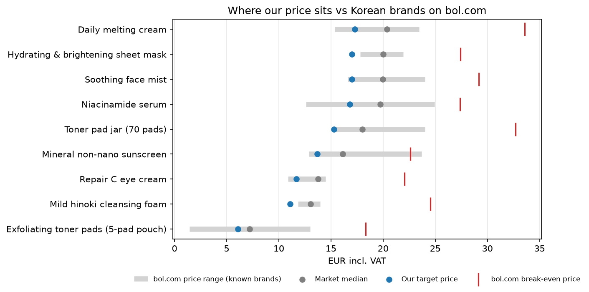
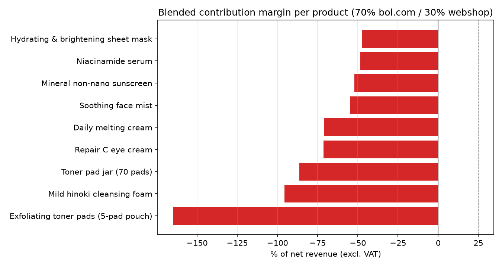
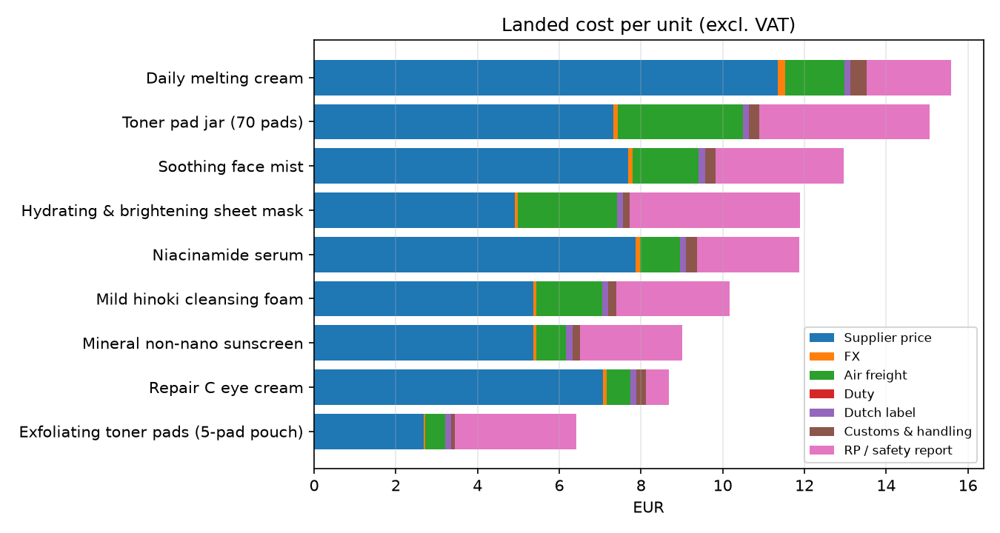

# Can a small Korean skincare brand compete on price in the Netherlands?

A unit-economics and price-competitiveness model for importing nine Korean skincare products into the Netherlands and selling them on **bol.com** and an **own webshop** (Instagram / Google ads).

The question: given a supplier's export prices and minimum order quantities (MOQ), can these products be sold at a competitive Dutch price and still make money after freight, import, compliance, marketplace fees, shipping and marketing?

**Tools:** Python (pandas) for the model, Matplotlib for charts, Excel output for scenario work. All assumptions live in `data/*.csv`, so they can be changed without touching the code.

---

## Short answer

**Not at the quoted prices.** In the base case all nine products lose money per unit sold. Even in an optimistic case (full market price, cheap freight, repeat order, low ad spend, bigger baskets), only the sheet mask reaches a ~20% margin. The main reason is simple:

> Dutch retail prices of comparable Korean brands are only **1.8–4.1×** the supplier price. A brand importer usually needs around **4–5×** to cover freight, fees, shipping and marketing.

| Product | Supplier price (USD) | MOQ | Landed cost (EUR) | bol.com market median (EUR) | Supplier price as % of net retail price |
|---|---|---|---|---|---|
| Toner pad jar (70 pads) | 8.20 | 60 | 15.07 | 18.01 | 58% |
| Hydrating & brightening sheet mask (box of 10, assumed) | 5.50 | 60 | 11.89 | 19.99 | 35% |
| Mineral non-nano sunscreen | 6.00 | 100 | 9.00 | 16.12 | 47% |
| Niacinamide serum | 8.80 | 100 | 11.87 | 19.74 | 57% |
| Soothing face mist | 8.60 | 80 | 12.95 | 19.95 | 55% |
| Daily melting cream | 12.70 | 120 | 15.60 | 20.38 | 79% |
| Mild hinoki cleansing foam | 6.00 | 90 | 10.17 | 13.04 | 59% |
| Repair C eye cream | 7.90 | 452 | 8.68 | 13.78 | 73% |
| Exfoliating toner pads (5-pad pouch) | 3.00 | 84 | 6.42 | 7.22* | 53% |

*Medicube 70-pad jar price scaled to 5 pads; the Starskin 5-pack sells for €13.

Landed cost = supplier price + FX + air freight + duty (0% under the EU–Korea FTA) + Dutch label + customs/handling + Responsible Person / safety report spread over the first batch.



---

## Key findings

**1. Every product loses money in the base case.** At 15% below the market median (an unknown brand has to undercut Beauty of Joseon, Anua, COSRX and others), the blended margin is between −47% and −165% of net revenue. Buying all nine MOQ batches would tie up about **€12,000** in stock, and selling everything would still lose about **€9,600**.



**2. The supplier price is the main problem, not the logistics.** For a bol.com sale of a €17 serum, roughly: 57% of the net price goes to the supplier, 28% to bol.com commission and ads, 29% to shipping and packaging. That's already over 100% before freight and compliance.



**3. Even the optimistic case only works for one product.**

| Product | Optimistic margin | Max supplier price for a 25% margin | Cut needed vs quote |
|---|---|---|---|
| Sheet mask | 21% | $4.73 | −14% |
| Sunscreen | 9% | $3.60 | −40% |
| Niacinamide serum | 6% | $5.36 | −39% |
| Soothing mist | 6% | $5.13 | −40% |
| Toner pad jar | −6% | $3.12 | −62% |
| Daily melting cream | −15% | $5.31 | −58% |
| Cleansing foam | −15% | $1.32 | −78% |
| Eye cream | −19% | $2.36 | −70% |
| 5-pad pouch | −38% | n/a | can't work as a standalone item |

The "max supplier price" column is the most useful output: it's a concrete negotiation target per product.

**4. Small, cheap items can't carry their own shipping.** The 5-pad pouch (€6–7 retail) pays ~€4 shipping and packaging per order. It only makes sense as a free sample or bundle add-on.

**5. The eye cream MOQ is the biggest cash risk.** 452 units = about €3,900 of stock, a third of the total, for the product with one of the worst margins.

---

## Method

1. **Supplier quote** (`data/supplier_quote.csv`): price and MOQ per product, plus estimated unit weight, HS code and pack size.
2. **Market prices** (`data/competitors.csv`): 37 comparable Korean products on bol.com, collected 14 October 2026, grouped by product type. The model uses the median per group.
3. **Landed cost** (`src/model.py`): ECB USD/EUR rate (0.894 on 13 Oct 2026) plus a bank FX spread, air freight by weight, 0% duty with an EU–Korea FTA origin statement (4% on the cleansing foam without it), Dutch labels, customs broker fees shared by order value, and Responsible Person / safety assessment costs spread over the first batch.
4. **Channels:**
   - **bol.com:** commission 12% + €0.55 (bol's beauty range is 5–15% + €0.20–0.85), shipping label and packaging, sponsored-product ads at 8% of price.
   - **Own webshop:** payment fees, PostNL shipping, and an Instagram/Google ad cost of €12 per order, spread over 2 items per order.
   - Blended at 70% bol.com / 30% webshop.
5. **Scenarios and sensitivity:** an optimistic scenario (`data/scenarios.csv`) and sensitivity tables for ad cost, price level and freight in the Excel file.

## Limitations

- **Several inputs are estimates**, marked `low` confidence in `data/assumptions.csv`: freight per kg, customs fees, shipping rates (PostNL's tariff page couldn't be loaded) and ad costs. Replace them with real quotes.
- **Pack sizes are assumed** from product names. In particular, the sheet mask is assumed to be a box of 10. If $5.50 is for one sheet, it's far worse than shown.
- **bol.com prices are a snapshot** of search results on one day and include known brands. Prices change, and search results aren't the full market.
- **Not included:** your own time, storage, income tax, bol.com subscription changes, and the fact that a new brand may sell much more slowly than expected.

## How to run

```bash
pip install -r requirements.txt
python src/run_analysis.py
```

Outputs go to `outputs/`: CSV tables, three charts and `kbeauty_nl_pricing.xlsx` (summary, landed cost, batch economics, scenarios, competitors, assumptions, sensitivities).

*Built by Jeong A (Jay) Jeong, MSc Quantitative Finance, University of Amsterdam.*
